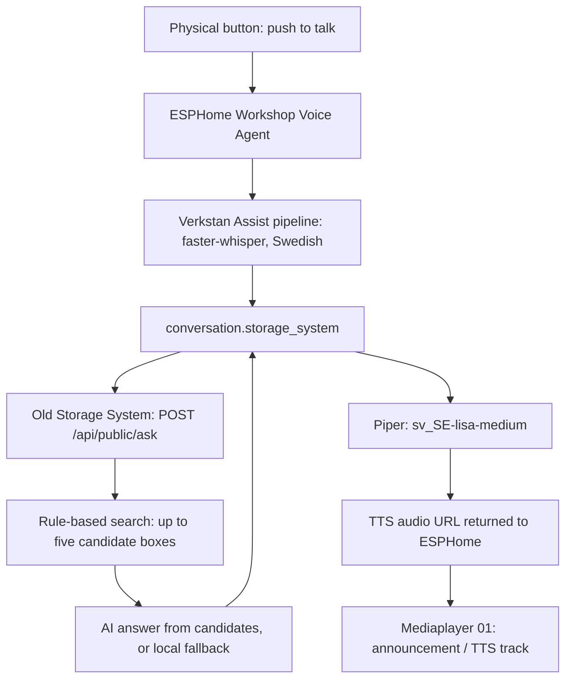
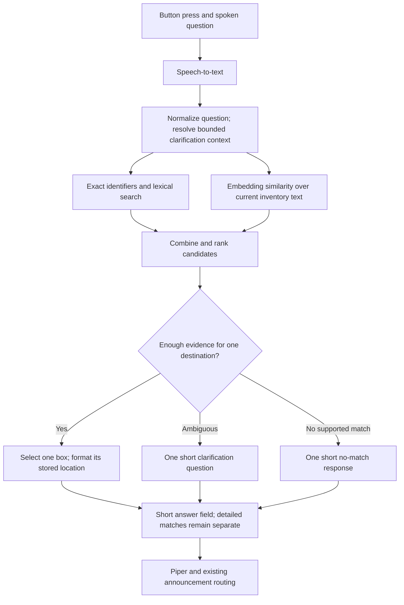

# Workshop voice search: current flow and proposed design

Recorded 2026-10-20. Application version: 0.9.1-dev. This document distinguishes
the existing production setup, the implemented replacement, and proposed work.
No production configuration, firmware or database was changed for this review.

## Primary requirement

Erik activates the wall-mounted workshop assistant with a button, not a wake word.
The normal spoken result should give one well-supported destination in one short
sentence. Do not read a list of alternative boxes or locations. A short, honest
clarification or no-match response is preferable to a confident but weak match.
Detailed candidates may remain visible on the screen or HA card.

Keep button activation. Proposed clarification support does not authorize
automatically opening the microphone or introducing wake-word activation.

## Existing production flow

The selected HA pipeline is **Verkstan**. Its settings use
`conversation.storage_system`, `stt.faster_whisper`, Swedish speech recognition,
`tts.piper` and voice `sv_SE-lisa-medium`. `prefer_local_intents` is enabled, so
HA may handle a recognized local intent before consulting the conversation agent.

The device's assistant selector is set to Verkstan and its output selector to
Mediaplayer 01. The relevant entity IDs are:

- `media_player.workshop_study_workshop_voice_agent`
- `select.workshop_study_workshop_voice_agent_assistent`
- `select.workshop_study_workshop_voice_agent_ljudutgang`
- `conversation.storage_system`
- `media_player.mediaplayer_01_mediaplayer_01`

In the local ESPHome source, the external button is GPIO16. A short press starts
listening when idle; depending on state it can instead dismiss the held result,
stop an active interaction, or silence a ringing timer. A hold of at least 1.5s
repeats the previous response. Touch and BOOT inputs also have relevant controls.
`start_listening` eventually calls `voice_assistant.start`. The presence of a
sound asset named `wake_word_triggered_sound` is not evidence of an active
wake-word detector.

The deployed HA conversation integration forwards recognized text unchanged to
`POST /api/public/ask`, with a body containing only `query`. It does not mark the
request as a voice request, send conversation context, or limit spoken candidates.
The old route calls `answerInventoryQuestion` in **public** mode. Its separate
voice prompt is used by the old web voice-search path, not by this HA call.

The old backend first performs lexical search, including word variants,
handwritten synonyms and short transpositions. It does not use embeddings or AI
to discover additional candidates. If candidates exist, it can send up to five
to an answer model. If that call fails, its local fallback explicitly lists up
to three matches. The conversation entity uses the complete returned `answer`
as speech and replaces semicolons with full stops. It does not remove alternatives.

ESPHome's `on_tts_start` stores the answer text for the display/repeat function.
`on_tts_end` stores the generated audio URL and calls `play_pending_tts`. With
Mediaplayer 01 selected, this calls HA `media_player.play_media` with `announce`
enabled, targeting `media_player.mediaplayer_01_mediaplayer_01`. That player's
ESPHome configuration has separate media and announcement pipelines. The
conversation path does not also call the integration's own TTS action.

### Observed symptoms

Read-only HA history on 2026-10-20 included:

- At 12:22 local time, the recognized USB-cable question produced an answer
  naming four locations.
- At 12:23, another question produced the local fallback listing three candidate
  boxes. The agent converts the separators into sentence breaks for speech.
- Some recorded transcriptions contain unusual wording. Without the original
  recording and intended utterance, this does not prove an STT error; recognition
  quality must be evaluated separately from retrieval and answer selection.

The long answer is already present before audio playback. Adjusting the speaker
or splitting sentences cannot decide which destination is actually justified.

### Evidence boundaries

Live HA reads verified the pipeline, selectors, entity states, recent answer
history and deployed `custom_components/storagesystem/{conversation,api}.py`.
The physical button and audio routing were inspected in the local ESPHome
configuration, not retested by pressing a button, flashing firmware or playing
audio. Old backend behavior was checked against the reference source at
`a92ed1d22f5bfb3e61a168e29bdae0b1ea04aadb`; no production backend settings or
private prompts were exported.

## Implemented replacement today

0.9.1-dev has shared lexical search for browser, REST and MCP, with Swedish word
variants, reference RC synonyms, short transpositions and retained filename
lookup. Image AI can propose saved descriptions/keywords, which become searchable
only after review and save.

Semantic retrieval, a dedicated voice decision policy and contextual follow-up
questions are **not implemented**. The replacement's current `/ask` uses a local
answer template and may also list multiple matches. Its existing real-HA Docker
acceptance proves transport/integration behavior, not precise spoken selection.

## Proposed retrieval and speech flow

### Retrieval

1. Preserve exact box IDs, product codes, dimensions and lexical matches.
2. Embed the user's query with the same embedding model used for the inventory.
3. Search reviewed, current inventory text: label, contents, keywords and useful
   current photo interpretations. Exclude retired session contents by default.
4. Combine the lexical and semantic results and deduplicate by box ID. Multiple
   photographs of one box must not become independent competing destinations.
5. Determine whether the leading candidate has sufficient evidence and a useful
   margin over other plausible candidates. Raw lexical scores and cosine
   similarity are not calibrated probabilities; do not invent a confidence
   percentage or copy Mimers Brain's thresholds.

An initial embedding per current box is sufficient to evaluate. If mixed-content
boxes hide specific items, add subordinate item/description chunks and aggregate
them back to their parent box. Even then, location and identity come from the
current inventory record, never from model-generated location text.

### Spoken-answer contract

| Decision | Proposed spoken behavior |
| --- | --- |
| One strongly supported destination | One short sentence with the item and its actual human-readable location |
| Several similarly supported destinations | One short distinguishing question; no list of locations |
| Insufficient evidence | One short no-match response; do not guess |

The decision to select, clarify or abstain belongs to application logic. An
optional language model may help evaluate a small candidate set, but it must
choose existing identifiers and report insufficient evidence when appropriate.
Validate its output. Use a deterministic location formatter for speech; a prompt
alone is not a guarantee that the output names only one place.

Keep the existing `answer` field short, because the deployed HA integration reads
that field. Preserve detailed candidates in `matches`. Optional decision fields
can be additive. A new `speech` field alone would have no effect on the current
integration. A future explicit answer mode must retain compatibility with clients
that currently send only `query`.

For example, a clear USB-cable match can yield:
"USB-kablarna finns på lagerhylla G, hylla 6, plats 2B."
If the cable type is genuinely ambiguous, ask:
"Vilken sorts USB-kabel söker du?"
These are design examples, not claims that the example destination is always
the correct answer for every cable request.

### Follow-up context and button behavior

The deployed agent returns HA's conversation ID but does not forward it or any
previous question to the storage backend. Thus a response such as "USB-C" cannot
currently be reliably interpreted as clarification of an earlier cable question.

Contextual clarification needs a compatible integration/API extension: carry a
conversation/session identifier, store a bounded pending question and candidate
set, expire it after a short configurable interval, and reset on a new topic.
Keep different devices/conversations separate. The user presses the button again
to provide the clarification; microphone activation remains user-controlled.
Test dismissal/repeat behavior so it does not accidentally replay or discard a
pending clarification.

## Database decision and actual scale

**Recommendation: retain SQLite for this application. PostgreSQL is not required
to obtain high-quality semantic retrieval at the observed or doubled scale.**

Mimers Brain does use PostgreSQL 17 with pgvector: its Compose file uses
`pgvector/pgvector:pg17`, the schema enables `vector`, and search combines cosine
similarity with lexical/title signals. That is its storage implementation, not
a prerequisite for the semantic method. An embedding model, document quality,
ranking/abstention policy and measured evaluation determine retrieval quality;
changing the database alone does not improve the meaning of the vectors.

### Read-only production measurement on 2026-10-20

The production MCP enumerated all 17 location groups and 164 unique boxes; group
counts and per-group listings agreed without failures. All 164 had nonempty
current summaries. The live old-system overview independently showed 164 boxes
with pictures and zero without pictures. Its 164 `.meta-count` fields summed to
293 current photo references. No inventory content, photo binaries, credentials
or runtime backup was copied into tracked repository files. A later user-authorized
private snapshot is documented in [SEMANTIC-EVALUATION.md](SEMANTIC-EVALUATION.md).

| Quantity | Observed | Conservative doubled example |
| --- | ---: | ---: |
| Boxes | 164 | 328 |
| Current photo references | 293 | 586 |
| Characters in labels + current summaries + keywords, joined with newlines | 18,941 | 37,882 |

The character count excludes photo notes, box notes, historical sessions and
database overhead. The photo count is current associations, not unique source
assets or all historical references. These are a dated snapshot; remeasure if
the user adds inventory.

Doubling photo references is distinct from doubling boxes. Adding Spread images
to existing boxes normally updates their descriptions and existing embeddings;
it need not double the number of search vectors. Source images stay in Immich or
PhotoPrism. Image recognition runs when the user requests analysis, not on every
voice search. More useful, reviewed descriptions can improve retrieval; simply
adding unanalysed photos does not automatically add semantic knowledge.

### Storage and execution approach

- Add a separate derived embedding table/cache in SQLite, keyed by current box
  or chunk ID, model/version/dimensions and a hash of the indexed text.
- Initially compare the small set of vectors directly in application memory,
  using cosine similarity. A dedicated approximate nearest-neighbor index or
  database extension is not needed to establish this small-corpus baseline.
- Illustrative size only: 164 vectors x 1536 dimensions x 4-byte floats =
  1,007,616 bytes (about 0.96 MiB); 328 vectors = 2,015,232 bytes (about 1.92 MiB).
  This excludes row/index/metadata overhead, assumes binary Float32 storage, and
  does not select the final model. More chunks increase vector count proportionally.
- Embed changed descriptions in the background. Keep model calls outside
  inventory transactions and reject stale job results using text/session identity.
  An embedding failure must not prevent a normal inventory save.
- Keep lexical search available during outages. Voice behavior must still
  abstain on uncertainty and make the fallback visible to diagnostics.
- Track missing/stale embeddings in the UI. Model changes require re-embedding;
  vectors from different models cannot be compared as if they were interchangeable.

The existing synchronous snapshot-based inventory writes are a separate
implementation constraint, documented in ARCHITECTURE.md. Keep derived vectors
out of that rewrite and benchmark actual write/search latency before expanding
scope. No performance benchmark or embedding-quality evaluation has yet been run
for the proposed semantic implementation.

Reconsider PostgreSQL/pgvector if measured load calls for many concurrent writers,
multiple application replicas, a substantially larger chunk corpus or server-side
vector indexing/operations. None follows from 164 boxes and a projected doubling.
The embedding service's availability/latency and the production network path to
it need explicit verification; the development Spark route still depends on the
laptop's GSA connection.

## Acceptance before enabling semantic voice search

1. Build a reviewed question set: exact names/codes, functional requests,
   Swedish/English terms, realistic STT variants, genuine ambiguity and absent items.
   Label correct boxes and cases that should clarify or abstain.
2. Compare current lexical search, semantic-only and hybrid search. Measure
   top-1 accuracy, incorrect confident answers, clarification/no-match decisions,
   ranking margins and end-to-end latency. Returning a correct box among five is
   not enough for a one-destination spoken answer.
3. Test that a weak first-ranked hit never becomes a confident spoken claim just
   because it is first. Exact codes and near-neighbor codes need explicit cases.
4. Use isolated real HA Docker acceptance for the answer contract, unavailable
   model fallback and follow-up isolation/expiry. Verify the actual HA client still
   consumes `answer`, and that cards can retain detailed `matches` independently.
5. Test the real button/STT/Piper/announcement path only in an authorized hardware
   session. Keep this distinct from the already passed synthetic HA runtime tests.

## Source references

- [ESPHome button, listening and output routing](../../ESPHome/workshop-voice-agent.yaml)
- [Mediaplayer announcement pipeline](../../ESPHome/mediaplayer-01.yaml)
- [Reference HA conversation agent](../../storagesystem-ha/custom_components/storagesystem/conversation.py)
- [Reference HA REST client](../../storagesystem-ha/custom_components/storagesystem/api.py)
- [Reference backend search/answer flow](../../Storagesystem/lib/public-api.ts)
- [Reference lexical search](../../Storagesystem/lib/search.ts)
- [Mimers Brain database configuration](../../Mimers-Brain/docker-compose.yml)
- [Mimers Brain search](../../Mimers-Brain/server/lib.mjs)
- [SQLite: appropriate uses](https://www.sqlite.org/whentouse.html)
- [Sentence Transformers: semantic retrieval and direct small-corpus comparison](https://www.sbert.net/examples/sentence_transformer/applications/semantic-search/README.html)

The sibling checkout links are local reference sources and may not resolve for
someone who clones only this repository. They do not imply a runtime dependency.
